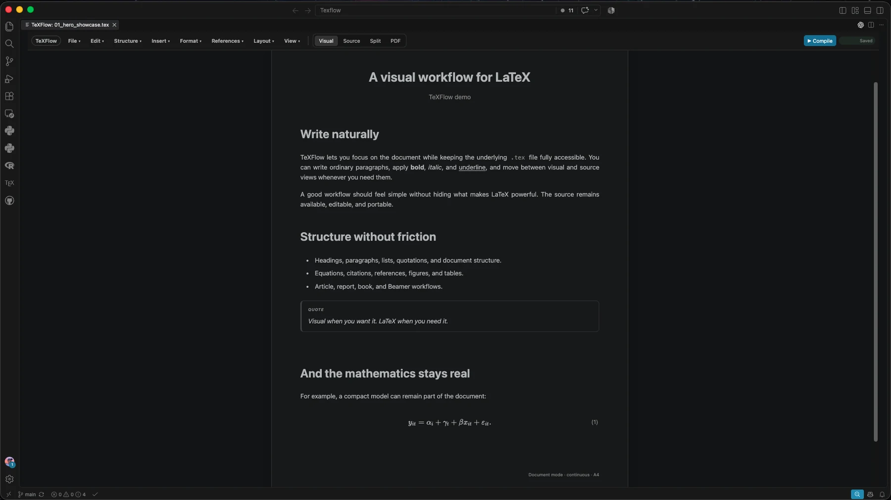

::: {.eh-home}

::: {.eh-hero}

::: {.eh-hero-copy}
::: {.eh-eyebrow}
Economist
:::

# Industrial Organization and Applied Microeconomics {.eh-title-line}

::: {.eh-lead}
Full Professor of Economics at Universidad de la República. Research on retail pricing, price dispersion, competition, and economic regulation.
:::

::: {.eh-secondary}
Applied work in competition policy, economic regulation, and market analysis.
:::

::: {.eh-inline-links}
[Research](research.html)
[CV](files/english_CV.pdf)
[Google Scholar](https://scholar.google.com/citations?user=UVdbgDwAAAAJ)
[Professional](professional.html)
:::
:::

::: {.eh-portrait}

:::

:::

::: {.eh-core}

::: {.eh-research}
::: {.eh-section-head}
::: {.eh-section-title}
::: {.eh-kicker}
Selected research
:::

## Recent papers
:::

[All research →](research.html){.eh-more}
:::

::: {.eh-paper}
::: {.eh-paper-meta}
2026 · Journal of Industry, Competition and Trade
:::

### [The Border Effect on Prices: The Role of Local Product Availability](https://link.springer.com/article/10.1007/s10842-026-00466-z)

Fernando Borraz and Leandro Zipitría.

::: {.eh-paper-links}
[Working paper](files/Disentangling_Border_2026.pdf)
:::
:::

::: {.eh-paper}
::: {.eh-paper-meta}
2024 · AEJ: Economic Policy
:::

### [Local Retail Prices, Product Varieties and Neighborhood Change](https://www.aeaweb.org/articles?id=10.1257/pol.20210817&&from=f)

Fernando Borraz, Felipe Carozzi, Nicolás González-Pampillón, and Leandro Zipitría.

::: {.eh-paper-links}
[Working paper](files/Borraz_AEJP_2021_R1.pdf)
:::
:::

::: {.eh-paper}
::: {.eh-paper-meta}
2022 · International Economics
:::

### [Varieties as a Source of Law of One Price Deviation](https://www.sciencedirect.com/science/article/abs/pii/S2110701722000543)

Fernando Borraz and Leandro Zipitría.

::: {.eh-paper-links}
[Working paper](<files/LOP Version 2021_12_11.pdf>)
:::
:::

:::

::: {.eh-side}
::: {.eh-side-block}
::: {.eh-kicker}
Professional
:::

## Competition, regulation & market analysis

Applied work in competition policy, economic regulation, market analysis, pricing, and regulatory impact.

::: {.eh-prof-meta}
Government · international organizations · private firms
:::

[Professional work →](professional.html){.eh-text-link}
:::
:::

:::

::: {.eh-lower}

::: {.eh-texflow}
::: {.eh-tf-copy}
::: {.eh-kicker .eh-kicker-light}
TeXFlow — Visual LaTeX
:::

## Write LaTeX, without writing LaTeX.

A visual LaTeX editor inside VS Code, while the `.tex` file remains the source of truth.

::: {.eh-tf-links}
[TeXFlow](texflow.html)
[GitHub](https://github.com/LeandroZipitria/texflow)
[Marketplace](https://marketplace.visualstudio.com/items?itemName=leandrozipitria.texflow)
:::
:::

::: {.eh-tf-shot}

:::
:::

::: {.eh-more-links}
::: {.eh-kicker}
More
:::

[Writing & Media](blog.html)
[Personal](personal.html)
[Contact](contact.html)
:::

:::

:::
